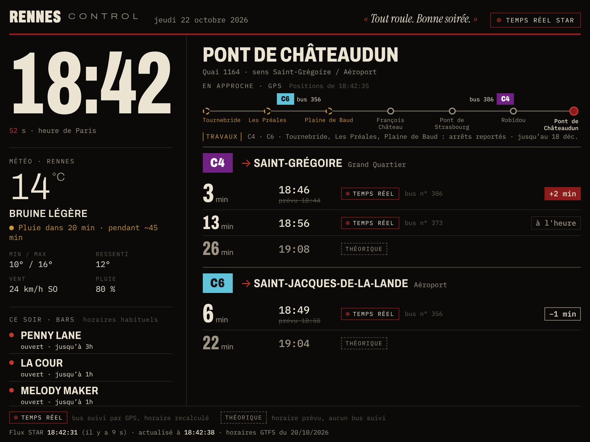

# Rennes Control

A wall dashboard for an old iPad (landscape): Paris time, Rennes weather and the
**next STAR buses at the Pont de Châteaudun stop** in Rennes, France:

- **C4** → Saint-Grégoire (Grand Quartier)
- **C6** → Saint-Jacques-de-la-Lande (Airport)

**Live:** https://laurentcbn.github.io/rennes-control/



*The real interface, shown here with illustrative values (18:42, buses 386 / 356) for the screenshot.*

Every time on screen comes from official STAR open data. The app never invents or
estimates a departure, and it never presents a timetable as real time.

## Features

- **Next departures**: countdown, time, delay, cancellations, with a clear *real-time* / *scheduled* label
- **Approaching buses**: the six stops before yours, with buses moving along them from their GPS position
- **Strikes and service alerts**: red banner for strikes; works near your stop shown under the track
- **Weather**: current conditions, *will it rain within the hour and for how long*, hourly forecast
- **Tonight's bars** (4 pm – 3 am): open / closing soon / opens at…, open ones first
- **The butler**: one dry, polite line at the top that comments on the real situation
- Fits one screen (iPad Air 2, Safari), refreshes itself, no page reloads

## Data sources

| Data | Source | Format | Browser access |
|---|---|---|---|
| Real-time departures | [STAR GTFS-RT Trip Updates](https://proxy.transport.data.gouv.fr/resource/star-rennes-integration-gtfs-rt-trip-update) (official transport.data.gouv.fr proxy) | GTFS-RT 2.0 Protobuf | Yes, `Access-Control-Allow-Origin: *` |
| Bus positions (GPS) | [STAR GTFS-RT Vehicle Positions](https://proxy.transport.data.gouv.fr/resource/star-rennes-integration-gtfs-rt-vehicle-position) | GTFS-RT 2.0 Protobuf | Yes (CORS `*`) |
| Strikes, works | [STAR GTFS-RT Alerts](https://proxy.transport.data.gouv.fr/resource/star-rennes-integration-gtfs-rt-alerts) | GTFS-RT 2.0 Protobuf | Yes (CORS `*`) |
| Timetable | [Current STAR GTFS](https://eu.ftp.opendatasoft.com/star/gtfs/GTFS_STAR_BUS_METRO_EN_COURS.zip), listed on [transport.data.gouv.fr](https://transport.data.gouv.fr/datasets/versions-des-horaires-theoriques-des-lignes-de-bus-et-de-metro-du-reseau-star-dans-les-formats-gtfs-et-netex-ainsi-que-les-urls-dacces-au-gtfs-rt-1) | GTFS zip → `data/schedule.json` | Static file of the site |
| Weather | [Open-Meteo](https://open-meteo.com/) (Météo-France model for the 15-minute rain forecast) | JSON | Yes, no key |
| Bar opening hours | `data/bars.json`, usual hours taken from [Schlouk Map](https://www.schlouk-map.com/) | JSON | Static file |

**No backend and no API key.** The GTFS-RT feeds allow cross-origin requests, so the
browser downloads them and decodes the Protobuf itself (`assets/gtfsrt.js`, a
dependency-free decoder checked field by field against Google's reference bindings).

The Rennes Métropole JSON dataset *"prochains passages des lignes de bus STAR en temps
réel"* (data.rennesmetropole.fr / data.explore.star.fr) could not be reached from the
development environment, so the integration relies on GTFS-RT, verified end to end.

### Verified identifiers (GTFS of 20 Oct 2026)

| Item | Value |
|---|---|
| Pont de Châteaudun, platform for C4 → Saint-Grégoire and C6 → Airport | `stop_id 7-1164` (code 1164) |
| Opposite platform (C4 → ZA Saint-Sulpice, C6 → Cesson) | `7-1171`, not shown |
| Line C4 | `route_id 7-0004`, `direction_id 0`, terminus `Grand Quartier` |
| Line C6 | `route_id 7-0006`, `direction_id 0`, termini `Aéroport` / `Saint-Jacques Aéroport` |

C4 short trips ending at *République* (same platform, same direction) do not go to
Saint-Grégoire and are deliberately left out.

## Display rules

- **Real time** (red dot): the trip has a **vehicle assigned** in the GTFS-RT feed.
  The time shown is STAR's prediction. The delay (`+2 min`, `−1 min`, `à l'heure`)
  is the gap between that prediction and the GTFS time of the same `trip_id`, and is
  shown only in this case.
- **Scheduled** (dashed frame): no vehicle tracked, so this is the published
  timetable. The STAR feed also lists untracked trips whose time is a copy of the
  timetable; they are never presented as real time.
- **Cancelled**: trip `CANCELED`/`DELETED`, or stop `SKIPPED`, in the feed.
- Departures are sorted by time. On the iPad the board drops the last departures
  until everything fits on one screen.
- **Freshness**: the footer shows when STAR generated the feed and when the page
  last refreshed. Past 2 min 30 a warning appears; past 7 min the feed is ignored
  and only the timetable remains, with an explicit banner.
- **Time zones and DST**: all times are UTC timestamps. GTFS times are converted
  with the "noon minus 12 h" rule of the service day (`zoneinfo` Europe/Paris), and
  the display is forced to `Europe/Paris` whatever the device setting.

## Approaching buses

C4 and C6 share the same six stops before Pont de Châteaudun (Tournebride → Les
Préales → Plaine de Baud → François Château → Pont de Strasbourg → Robidou). A single
track shows the buses of both lines heading to the stop, from the STAR GPS feed
(refreshed every 15 s):

- position = the stop where the bus is standing (`STOPPED_AT`), or between two stops
  by projecting its GPS fix on the segment;
- a fix more than 1 km away from the announced segment is treated as unreliable and
  not drawn; a bus at a temporary stop (works) is placed if its fix is within 300 m
  of the track;
- only trips of the board (right line, direction and destination) are shown, and a
  fix older than 5 min is ignored;
- a real-time bus not yet on these six stops waits on the left with "← plus loin".

The stop list is extracted from the GTFS by `tools/build_schedule.py` (`tracks` field).

## Strikes and service alerts

The STAR alerts feed is read every 5 min. Only alerts that matter at Pont de
Châteaudun are shown:

- **red banner**: strike, demonstration, no or reduced service on the whole network
  or on C4 / C6, ongoing or announced within 36 h;
- **quiet line under the track**: other active C4 / C6 alerts touching the stop or
  the six stops before it (moved stops are dashed orange on the track); several
  alerts rotate every 8 s;
- alerts about stops elsewhere on the lines are ignored.

## Rain within the hour

Under the weather, one line answers "will it rain within the hour, and for how
long?" from Open-Meteo's 15-minute precipitation forecast (`minutely_15`): "Pas de
pluie dans l'heure", "Pluie dans 20 min · pendant ~45 min", "Il pleut · encore
~30 min". Threshold: 0.1 mm per quarter hour (`assets/rain.js`).

## Tonight's bars

From 4 pm to 3 am the hourly forecast gives way to "Ce soir · bars": open / closing
soon / opens at…, computed in Paris time, closing times after midnight included.
Open bars come first, then the order of `data/bars.json`. The hours there are
**usual hours** taken from schlouk-map.com (Oct 2026); they are unofficial and
sources sometimes disagree. Edit the file to fix an hour or add a bar.

## The butler

One line at the top comments on the real situation: strike, bus about to arrive,
rain, delay, early bus, time of day (`assets/butler.js`).

## Run locally

```bash
cd rennes-control
python3 tools/build_schedule.py      # downloads the STAR GTFS → data/schedule.json
python3 -m http.server 8000          # then open http://localhost:8000
```

Python 3.9+, no dependency. Opening `index.html` as `file://` does not work because
the browser blocks reading `data/schedule.json`: use an HTTP server.

## Tests

```bash
node tests/unit.js                   # timetable / real-time merge, cancellations, delays, labels
node tests/track.js                  # bus placement on the track (real stop coordinates)
node tests/alerts.js                 # alert filtering (announced strike, works, out-of-area alerts)
node tests/butler.js                 # butler lines
node tests/bars.js                   # bar opening status (including after midnight)
node tests/rain.js                   # rain within the hour (quarter-hour slots)
node tests/live_board.js             # downloads the real feed and prints the C4 / C6 board
pip install gtfs-realtime-bindings
python3 tests/compare_decoder.py feed.pb   # JS decoder vs Google's reference decoder
python3 tests/compare_vehicles.py vp.pb    # same for GPS positions
python3 tests/compare_alerts.py alerts.pb  # same for alerts
NODE_PATH=$(npm root -g) node tests/browser_check.js http://localhost:8000/   # Playwright, iPad viewport
```

If `live_board.js` prints `feed HTTP 5xx` or `fetch failed`, the STAR feed or the
network is down, not the code. The page then shows the timetable with a "Temps réel
indisponible" banner.

## Deployment (GitHub Pages)

1. Push this folder to `main` of a GitHub repository.
2. *Settings → Pages → Build and deployment → Source: **GitHub Actions***.
3. `.github/workflows/deploy.yml` rebuilds `data/schedule.json` on every push **and
   every night** (STAR publishes a new GTFS weekly), runs the tests, stamps asset URLs
   so Safari never mixes versions, and publishes to `https://<user>.github.io/rennes-control/`.

The site is fully static. Any static host works (Netlify, Cloudflare Pages, a
Raspberry Pi with nginx…) as long as `tools/build_schedule.py` runs at least weekly.

Should the transport.data.gouv.fr proxy ever drop its CORS header, a relay that copies
the feed is enough (no key needed): open `index.html?feed=https://my-relay/trip-update`.

## On the iPad Air 2

- Safari → Share → **Add to Home Screen**: full screen, no toolbar.
- Settings → Display & Brightness → Auto-Lock: **Never** (or Guided Access).
- iOS 12 to 15 compatible: ES2017 JavaScript, no library.

## Project layout

```
index.html              page
assets/style.css        design (black, cream, dark red)
assets/app.js           clock, weather, refresh loop, rendering, screen fitting
assets/gtfsrt.js        GTFS-RT Protobuf decoder (trip updates, vehicle positions, alerts)
assets/departures.js    timetable + real-time merge, bus track, alert filtering
assets/butler.js        the butler's line
assets/rain.js          rain within the hour
assets/bars.js          bar opening status
data/schedule.json      timetable and track extracted from the GTFS (generated)
data/bars.json          bars and their usual hours (edit freely)
tools/build_schedule.py GTFS → schedule.json
tests/                  unit tests, live feed check, decoder comparisons, browser check
docs/screenshot.png     README screenshot
```
